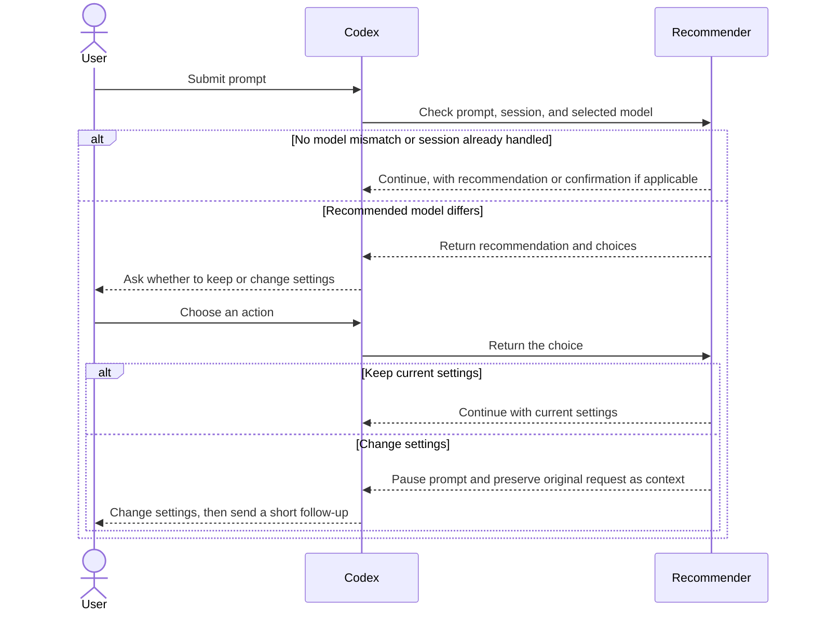

# Architecture

Model Recommender runs a local classifier before Codex sends the first prompt in a session. Codex hosts the plugin's MCP server and invokes its recommendation tool through a synchronous `UserPromptSubmit` hook. The hook can let the prompt continue or pause it while the user changes settings.

## Components

| Component | Responsibility |
| --- | --- |
| Codex host | Starts the plugin MCP server, calls the prompt hook, displays elicitation choices, and applies the hook result. |
| Plugin runtime | Checks whether setup is ready; if setup is missing or stale, prepares the private Python runtime, dependencies, and local classifier model before starting the MCP server. |
| Recommender MCP server | Receives the prompt, session ID, and selected model; runs the first-prompt guard and asks what to do when a recommendation differs. |
| Local Laya classifier | Classifies capability and reasoning demand using the configured questions. After setup, inference runs locally and offline. |
| User | Chooses whether to use current settings or change them. The plugin does not change model or reasoning settings. |

## Communication flow

## State and decision behavior

- A local hashed session marker is checked before classification and claimed after successful classification. Existing sessions continue without another recommendation. If elicitation fails, the marker is removed so the prompt can be retried.
- The classifier evaluates capability and reasoning effort together. The plugin compares only the recommended model with the selected model; it does not inspect or compare the active reasoning setting.
- Choosing current settings allows the submitted prompt to continue. Choosing to change settings blocks that submission and adds the original prompt as `UserPromptSubmit` additional context.
- A recommendation or elicitation error is reported to the user and the prompt continues with current settings. If the MCP server cannot start or connect, the hook cannot show the recommendation question.
