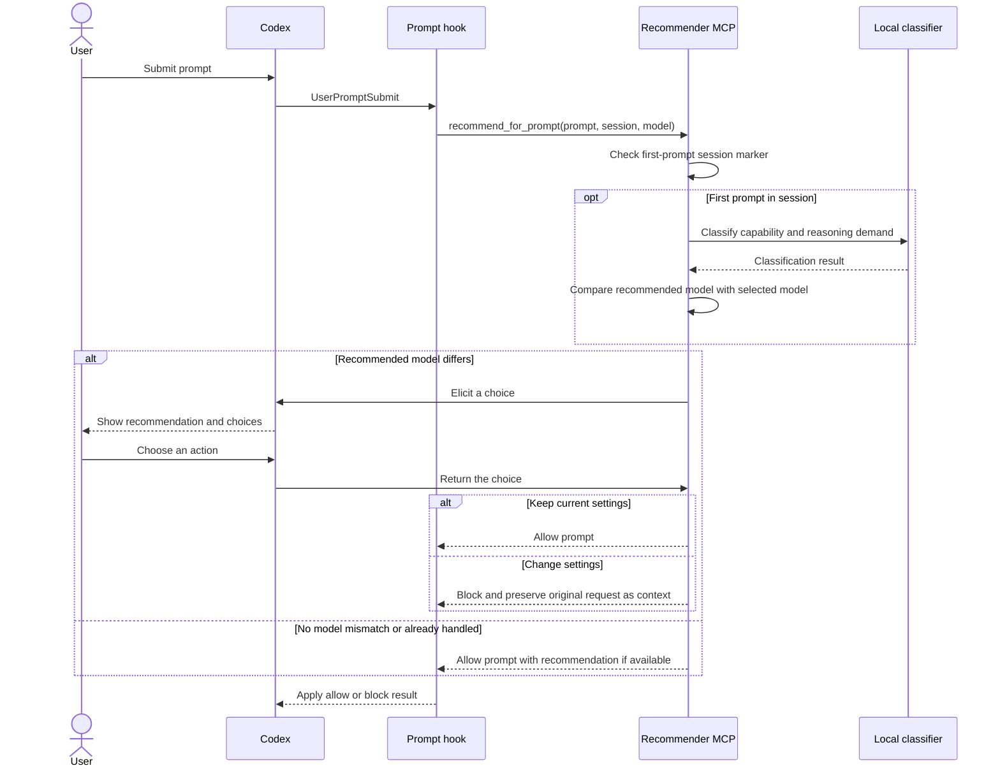

# Architecture

Before Codex processes a prompt, its `UserPromptSubmit` hook calls the recommendation tool on the plugin's MCP server. The server classifies the first prompt in a session and returns a result that lets the prompt continue or pauses it while the user changes settings.

## Components

| Component | Responsibility |
| --- | --- |
| Codex host | Runs the prompt hook, presents the user's choices, and applies the hook result. |
| `UserPromptSubmit` hook (`hooks.json`) | Calls the recommendation tool before the prompt proceeds and supplies the prompt, session ID, and selected model. |
| Plugin runtime (`runtime.sh`) | Prepares the private Python runtime, dependencies, and classifier model when needed, then starts the MCP server. |
| Recommender MCP server (`mcp_server.py`) | Checks whether this is the session's first prompt, coordinates classification and the user choice, and returns an allow or block result. |
| Session and classifier helpers (`hook.py`) | Track handled sessions, run local classification, and compare the recommended model with the selected model. |
| Local Laya classifier | Predicts capability and reasoning demand from the configured questions. Inference runs locally and offline after setup. |
| User | Chooses whether to keep current settings or change them. The plugin does not change settings. |

## Communication flow

## Decision behavior

- The server classifies only the first prompt in a session. It predicts capability and reasoning demand, but compares only the recommended model with the selected model.
- If the user keeps current settings, the prompt continues. If they choose to change settings, the hook blocks that submission and preserves the original request as context so a short follow-up can resume it.
- If recommendation or elicitation fails, the prompt continues with current settings. If the MCP server cannot start or connect, Codex cannot show the recommendation choices.
