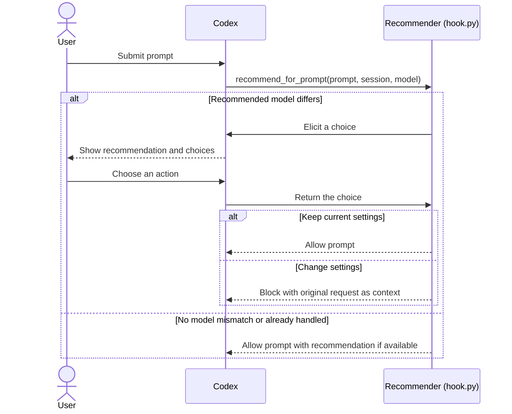

# Architecture

On each prompt, the `UserPromptSubmit` hook invokes `recommend_for_prompt` on the local MCP server started by `hook.py`. The server classifies only the first prompt in a session, then lets the prompt continue or pauses it while the user changes settings.

## Components

| Component | Responsibility |
| --- | --- |
| Codex host | Runs the prompt hook, presents the user's choices, and applies the hook result. |
| `UserPromptSubmit` hook (`hooks/hooks.json`) | Invokes the recommendation tool with the prompt, session ID, and selected model. |
| Plugin runtime (`runtime.sh`) | Prepares the private Python runtime, dependencies, and classifier model when needed, then starts `hook.py`. |
| Recommender MCP server (`hook.py`) | Tracks handled sessions, classifies prompts, compares the recommended model with the selected model, coordinates the user choice, and returns the hook result. |
| Local Laya classifier and `questions.json` | Predict capability and reasoning demand from the configured questions. Inference runs locally and offline after setup. |
| User | Chooses whether to keep current settings or change them. The plugin does not change settings. |

## Communication flow

## Decision behavior

- The server classifies only the first prompt in a session. It uses the model and reasoning labels from `questions.json` directly, but compares only the recommended model with the selected model.
- If the user keeps current settings, the prompt continues. If they choose to change settings, the hook blocks that submission and preserves the original request as context so a short follow-up can resume it.
- If recommendation or elicitation fails, the prompt continues with current settings. If the MCP server cannot start or connect, Codex cannot show the recommendation choices.
