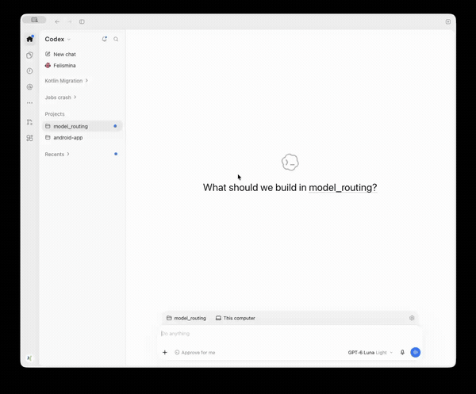

# Model Recommender

A Codex plugin that uses the local Laya classifier to recommend a model and reasoning level on the first prompt in each session. It classifies model tier and reasoning demand together, with a policy that favors **GPT-6 Luna · Medium** for bounded work.

## Install

Requires the Codex CLI with hook plugin support on macOS or Linux. Run these commands in Terminal before opening Codex:

```sh
codex plugin marketplace add pedromfmachado/laya-model-recommender
codex plugin add model-recommender@model-recommender-plugins
```

Open Codex, review and trust the hook in Hooks settings (or `/hooks` in the CLI), then start a new chat. If you use a custom `CODEX_HOME`, Codex uses that directory for its plugin cache and Model Recommender data.

## Use

Submit a prompt in a new chat. On the first prompt in a session, the hook shows its recommended model and reasoning level.

- If the recommended model differs from your current model, choose **Use my current settings for this prompt.** or **Change settings, then continue with this prompt.** Choosing the second option blocks the prompt but keeps the original request in context. After changing settings, send a short follow-up, such as “Continue,” to resume it. If your model matches, the prompt continues with a short confirmation.

The plugin leaves model and reasoning selection to you. See [ARCHITECTURE.md](ARCHITECTURE.md) for component responsibilities and the prompt flow.

## Demo



## Upgrade

Close Codex and run these commands in Terminal to fetch and install the latest version:

```sh
codex plugin marketplace upgrade model-recommender-plugins
codex plugin add model-recommender@model-recommender-plugins
```

Reopen Codex and start a new chat. If setup fails, see [Troubleshooting](#troubleshooting).

## Configuration

Edit `questions.json` to customize recommendation labels and classification guidance:

- `questions.json` defines the `capability` and `effort` choice questions, instructions, and option labels. The labels are the model and reasoning settings shown in the recommendation.

Capability labels use the model names `GPT-6 Luna` and `GPT-6.1 Sol`. Effort labels use the reasoning settings `Medium`, `High`, and `Extra High`.

Each question must use `type: "choice"` with nonempty instructions and option labels. Use the exact model names for capability labels and the exact reasoning settings for effort labels.

Reinstall or refresh the plugin to apply changes, then start a new chat.

## Troubleshooting

If a recommendation fails, Codex continues with the current settings. After fixing the issue, submit the prompt again to retry.
