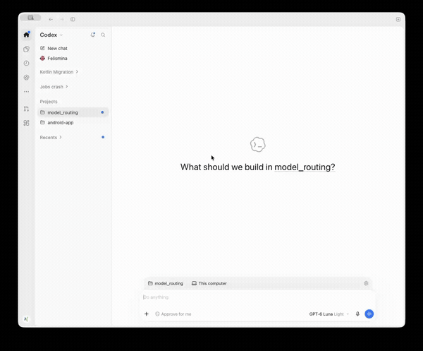

<div align="center">

# Model Recommender

Get a local model and reasoning recommendation for the first prompt in each Codex session.


[](LICENSE)

</div>

The plugin uses the Laya classifier on your computer. It recommends a model and reasoning level together, with a policy that favors **GPT-6 Luna · Medium** for bounded work. You choose whether to keep your current settings or change them.

## What to expect

On the first prompt in a session, the plugin compares its recommendation with your current settings when Codex makes them available. If the settings match, the prompt continues with a confirmation. If they differ, choose to continue with your current settings or change settings first. The second choice pauses the prompt and preserves your request. After changing settings, send a short follow-up such as "Continue".

Prompt classification runs locally. Setup needs internet access to download the runtime, dependencies, and classifier model. After setup, inference runs offline.

## Install

Requires the Codex CLI with hook plugin support on macOS or Linux. Run these commands in Terminal before opening Codex:

```sh
codex plugin marketplace add pedromfmachado/laya-model-recommender
codex plugin add model-recommender@model-recommender-plugins
```

On first startup, setup downloads a private Python runtime, the classifier dependencies, and the model. This can take several minutes. The files go under `${CODEX_HOME:-$HOME/.codex}/model-recommender`. You do not need to install Python or pip packages yourself.

Open Codex, review and trust the hook in Hooks settings (or `/hooks` in the CLI), then start a new chat. With a custom `CODEX_HOME`, the plugin cache and local data use that directory.

## See it in action



For a smaller video download, use [WebM](media/model-recommender-demo.webm) or [MP4](media/model-recommender-demo.mp4).

## Upgrade

Close Codex and run these commands in Terminal:

```sh
codex plugin marketplace upgrade model-recommender-plugins
codex plugin add model-recommender@model-recommender-plugins
```

Reopen Codex and start a new chat. If setup fails, see [Troubleshooting](#troubleshooting).

## Configuration

Edit `questions.json` to customize the recommendation labels and classification guidance. It defines the `capability` and `effort` questions, instructions, and option labels. The labels are the model and reasoning settings shown in the recommendation.

Capability labels use `GPT-6 Luna`, `GPT-6.1 Terra`, and `GPT-6.1 Sol`. Effort labels use `Medium`, `High`, and `Extra High`. Keep the exact model and reasoning setting names. Each question must use `type: "choice"` with nonempty instructions and option labels.

Refresh or reinstall the plugin to apply changes, then start a new chat.

## Troubleshooting

If setup fails, check the error printed in the terminal, resolve it, and restart Codex. Setup retries when the plugin starts. Setup requires internet access. If a recommendation fails after setup, Codex continues with your current settings. Fix the reported dependency or model issue, then submit the prompt again.

## Uninstall

Remove the plugin through the Codex plugin manager. To also remove downloaded runtime and model files, delete `${CODEX_HOME:-$HOME/.codex}/model-recommender`. The plugin stores session markers separately in `${CODEX_HOME:-$HOME/.codex}/model-routing/sessions`; delete that directory to remove them too.

## Project docs

- [Architecture](ARCHITECTURE.md) describes the hook flow and component responsibilities.
- [Contributing](CONTRIBUTING.md) explains how to propose a change.
- [Changelog](CHANGELOG.md) records project releases.
- [MIT license](LICENSE) describes the project's reuse terms.
